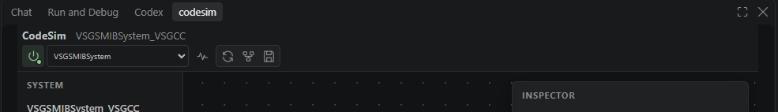

# CodeSim - Building power system symbolically!

CodeSim is a Python-first toolkit for modelling and analysing converter-dominated power systems. 
It allows you to build device models and power systems completely based on symbolic equations.
This toolkit enables numerical simulation, small-signal and interaction analysis. The UI is based on VS Code extension, which facilitates developing your own device and system models.


## Features

Tired of dragging messy control blocks and circuit elements in Simulink / PSCAD?  Here are the reasons for choosing CodeSim!

- Symbolic EMT level device and network equations with inspectable state-space ODEs.
- Auto steady-state initialization and time-domain simulation.
- Small-signal modes, damping ratios, dominant states, and participation results.
- Converter-interaction analysis for identifying the critical feedback loop.
- Well-designed UI for tuning parameters, developing new models, thanks to VS Code platform.
- Transparent, AI-friendly, light-weight and fast startup.

## Requirements

- Python 3.10 or newer.
- Python packages: `numpy`, `scipy`, and `sympy`.
- Visual Studio Code for the graphical interface.
- Node.js and npm only when developing or rebuilding the extension.

## Quick start

### 1. Prepare Python

Install python on your computer and the runtime dependencies:

```powershell
python -m pip install numpy scipy sympy
```

### 2. Install the VS Code extension

1. Open the VS Code **Extensions** view.
2. Open the `...` menu and choose **Install from VSIX...**.
3. Select `frontend/codesim-frontend-0.1.1.vsix`.
4. Reload the VS Code window.

### 3. Configure CodeSim

Then you should see the codesim dialog in the VS Code sidebar. If not, right click the left toolbar and select codesim.



Open the Command Palette (The textarea on the top of VSCode) and run:

- **CodeSim: Select Python Executable** to select a detected Python/Conda environment or browse to an executable.
- **CodeSim: Select Backend Directory** to select either the project root containing `codesimpy` or the `codesimpy` directory itself.

The equivalent settings are:

```json
{
  "codesim-frontend.pythonExecutable": "C:\\path\\to\\python.exe",
  "codesim-frontend.backendPath": "C:\\path\\to\\codesim"
}
```

Click 'Start python backend' icon, if successful, the button will turn green. Then you should see the example systems in the dropdown list.

### 4. Load and analyse a system

1. Select a system from the dropdown. Selecting it loads the model automatically.
2. Edit parameters or inspect components in the topology view.
3. Open **Signals** using the waveform icon.
4. Run **Simulate**, **Small signal**, or **Interaction** from the Signals toolbar.

The topology toolbar also provides refresh, automatic layout, and layout-save actions. The Signals view allows plots to be added or closed and signals to be assigned from the list on the right.

## Included systems

| System | Description |
| --- | --- |
| `HybridSystem` | Current-limited GFM with an optional parallel GFL connected to an infinite bus |
| `VSGSMIBSystem` | VSG single-machine infinite-bus fault study using `VSGCC` or `VSGCL` |
| `GFLLVRTSystem` | Grid-following converter low-voltage ride-through study |
| `ParallelVSGSystem` | Two VSGs connected in parallel through separate branches |
| `SGSMIBSystem` | Synchronous-generator single-machine infinite-bus study |
| `IEEE13System` | IEEE 13-bus distribution system with optional converters |
| `CIGREMV14System` | CIGRE MV 14-bus system with VSG integration and fault studies |

The list shown by the frontend comes from `SystemFactory.systemNames`; it is not hard-coded in the extension.

## Project structure

```text
codesim/
├─ codesimpy/
│  ├─ api/
│  │  ├─ cli.py                  Resident stdio service and analysis endpoints
│  │  └─ system_factory.py       System registry, defaults, and construction
│  ├─ components/                Converter, machine, source, and load models
│  ├─ core/
│  │  ├─ device.py               Device base class
│  │  ├─ system.py               Initialization, integration, and signals
│  │  ├─ rl_grid.py              Symbolic/numerical RL network model
│  │  ├─ small_signal_analyzer.py
│  │  └─ output_json_factory.py  Stdout and snapshot serialization
│  ├─ systems/                   Seven runnable system definitions
│  ├─ tests/                     Python unit and service tests
│  └─ README.md                  Python package documentation
├─ frontend/
│  ├─ src/extension.ts           VS Code extension host
│  ├─ webview/src/               React topology and signal views
│  ├─ media/                     Extension assets
│  ├─ package.json               Commands, settings, and build scripts
│  └─ README.md                  Frontend development documentation
├─ codegen/                      Generated snapshots; ignored by Git
├─ tests/                        Reserved project-level tests
├─ README.md
└─ LICENSE
```

## Extending CodeSim

### Add a system

1. Add a `System` subclass under `codesimpy/systems/`.
2. Define its devices, network, base values, references, parameters, and parameter names.
3. Implement `calculateSignals(time_s, state, networkSignals)`.
4. Export it from `codesimpy/systems/__init__.py`.
5. Register the class, default parameters, and options in `codesimpy/api/system_factory.py`.
6. Add a focused test under `codesimpy/tests/`.

### Add a component

Subclass `codesimpy.core.Device` and implement:

| Method | Purpose |
| --- | --- |
| `getStateAndOutputEquationsSym` | Return symbolic state equations and port outputs |
| `getPowerFlowEquations` | Return power-flow constraints |
| `initFromPowerFlow` | Construct the initial device state |
| `getFInit` | Return residual equations used during initialization |

Export the class from `codesimpy/components/__init__.py` and instantiate it in a system. Add a `deviceAppearance` mapping only when the frontend needs a dedicated category or icon.

## Current limitations

- Three-phase unbalanced systems have not yet been validated.
- Detailed switching models and switching events are not supported.
- Interaction analysis is currently specific to `HybridSystem` with GFL enabled.
- The project is a research-oriented model library rather than a replacement for switching-level EMT tools.

## License and policies

CodeSim is licensed under the [Apache License, Version 2.0](LICENSE).

- Contributions: [CONTRIBUTING.md](CONTRIBUTING.md)
- Security reports: [SECURITY.md](SECURITY.md)
- Third-party notices: [THIRD_PARTY_NOTICES](THIRD_PARTY_NOTICES)
- Project name and logo: [TRADEMARKS.md](TRADEMARKS.md)
