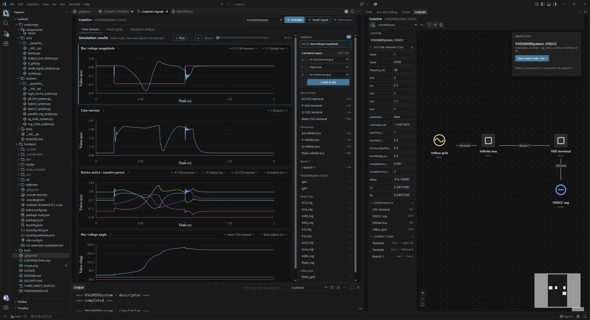

# CodeSim

CodeSim is a code-first toolkit for modelling and analysing converter-dominated power systems. It combines symbolic MATLAB models with a VS Code interface for topology inspection, parameter editing, simulation, and stability analysis.
CodeSim is designed for research workflows that require transparent equations and repeatable studies. 

## Key features

| Feature | What CodeSim provides | Benefit |
| --- | --- | --- |
| Symbolic modelling | Devices and systems are assembled from explicit state equations `f`, port equations `g`, and network equations | Equations, states, and parameters remain inspectable and traceable |
| Power flow and initialization | Power flow and internal device states are solved through one model | Less manual initialization and fewer artificial start-up transients |
| Small-signal analysis | Symbolic state-space construction, eigenvalues, damping, and participation factors | Modes can be traced back to states, devices, and equations |
| Interaction analysis | Network reduction and converter-interaction analysis | Helps identify coupling paths between GFM, GFL, and the grid |
| Time-domain simulation | Faults and reference changes are defined in code and run through a common solver | Suitable for parameter sweeps, automated tests, and reproducible studies |
| VS Code interface | Editable parameters, system topology, waveforms, and stability results | One interface for model configuration and result inspection |

## Comparison

| Area | CodeSim | Simulink / Simscape Electrical | PSCAD |
| --- | --- | --- | --- |
| Primary focus | Transparent equations, stability mechanisms, and research automation | General dynamic-system, control, and multiphysics modelling | Detailed electromagnetic-transient simulation |
| Model construction | MATLAB classes and symbolic equations | Graphical blocks and physical networks | Graphical electrical networks and control blocks |
| Equation visibility | `f`, `g`, state matrices, and parameter mappings are directly available | Complete assembled equations normally require additional tools | Complete equations are not the primary user interface |
| Small-signal studies | Native symbolic linearisation linked to device states | Mature numerical linearisation and control-analysis ecosystem | Usually requires additional studies or external tools |
| Time-domain studies | Best suited to averaged converter models and electromechanical dynamics | Broad support for controls, averaged models, and multiphysics systems | Strongest for switching detail, protection, and fast EMT phenomena |
| Automation and version control | Models, events, and parameters are plain code | Automatable, but graphical-model diffs are less direct | Supports batch studies, but project diffs are less code-oriented |
| Model ecosystem | Focused research library that is easy to extend | Large commercial toolbox and hardware-integration ecosystem | Mature power-system EMT libraries and engineering workflows |

Choose CodeSim when explicit equations, traceable small-signal results, converter interactions, or large automated studies are central. Choose Simulink for broad control and multiphysics workflows, and PSCAD for switching-level detail, unbalanced networks, and fast EMT studies.

## Requirements

- MATLAB with Symbolic Math Toolbox
- A compatible version of VS Code
- The CodeSim source folder and CodeSim VS Code extension (`.vsix`)

## Get started


### 1. Install the CodeSim extension

1. Open the **Extensions** view in VS Code.
2. Open the `...` menu and select **Install from VSIX...**.
3. Select `frontend/codesim-frontend-*.vsix` from the CodeSim distribution.
4. Run **Developer: Reload Window** when prompted.

### 2. Extract and open the project

1. Extract the complete `codesim` folder to a local directory.
2. In VS Code, select **File > Open Folder...** and open the extracted `codesim` folder—not the `+codesim` package folder.
3. Click the **CodeSim** icon in the Activity Bar.

The extension normally discovers the MATLAB backend automatically. If it does not, set:

- `codesim-frontend.backendPath` to the folder containing `+codesim`
- `codesim-frontend.matlabExecutable` to the MATLAB executable; the default is `matlab`

### 3. Load a system

1. Select a System from the toolbar, for example `VSGSMIBSystem`.
2. Click **Load**.
3. Edit system parameters in the **System Parameters** section.
4. Select a component in the topology to inspect or edit its parameters.

### 4. Open Signals

Click **Signals** in the toolbar. CodeSim opens the results view, where time-domain waveforms, small-signal results, and interaction-analysis results are organised on separate tabs.

### 5. Run a time-domain simulation

1. Return to the system view and adjust the required parameters.
2. Click **Simulate**.
3. Follow MATLAB progress in the **CodeSim** Output channel.
4. When the run finishes, the Signals view updates from the generated snapshot automatically.

Use the signal list to select displayed quantities. Plot zoom and reset controls are available above the charts.

### 6. Run stability analyses

- Click **Small signal** to calculate eigenvalues, damping, participation factors, and the symbolic `f`, `g`, and state-space matrix.
- Click **Interaction** to run converter-interaction analysis. This is currently available for `HybridSystem` with GFL enabled.
- Click **Refresh** to reload the latest snapshot without rerunning MATLAB.

Generated snapshots and numerical-function caches are stored under `codegen/`.

## Included systems

| System | Description |
| --- | --- |
| `HybridSystem` | Current-limited GFM with an optional parallel GFL connected to an infinite bus |
| `VSGSMIBSystem` | VSG single-machine infinite-bus fault study using `VSGCC` or `VSGCL` |
| `GFLLVRTSystem` | Grid-following converter low-voltage ride-through study |
| `ParallelVSGSystem` | Two VSGs connected in parallel through separate branches |
| `SGSMIBSystem` | Synchronous-generator single-machine infinite-bus system |
| `IEEE13System` | IEEE 13-bus distribution system with optional converters |
| `CIGREMV14System` | CIGRE MV 14-bus system with VSG integration and fault studies |

## MATLAB API

The UI calls two public entry points. `Descriptor` loads the model metadata without running an analysis; `Runner` initializes the model, runs the selected analyses, and updates the snapshot.

```matlab
addpath('C:\path\to\codesim');

[descriptorFile, descriptor] = codesim.api.Descriptor( ...
    "HybridSystem", struct(), struct());

options = struct( ...
    'RunTimeDomain', true, ...
    'RunSmallSignal', true, ...
    'RunInteractionAnalysis', false);

[snapshotFile, result] = codesim.api.Runner( ...
    "HybridSystem", struct('SCR', 2.0), options);
```

## Project structure

```text
codesim/
├─ +codesim/
│  ├─ +api/          Descriptor, Runner, and SystemFactory
│  ├─ +components/   Device implementations
│  ├─ +core/         System, Device, RLGrid, analysis, and JSON output
│  ├─ +systems/      Systems available to the API and UI
│  └─ livescripts/   Research and example scripts
├─ codegen/          Generated snapshots and numerical-function caches
├─ frontend/         VS Code extension and React webview
├─ tests/            MATLAB smoke tests
└─ README.md
```

## Extending CodeSim

### Add a System

1. Create a subclass of `codesim.core.System` in `+codesim/+systems`.
2. Define the devices, network, base values, reference map, parameters, and parameter names.
3. Implement the protected `calculateSignals` method.
4. Register the constructor and default parameters in `+codesim/+api/SystemFactory.m`.
5. Verify the model with `codesim.api.Descriptor` before running numerical analyses.

### Add a Device

Create a subclass of `codesim.core.Device` in `+codesim/+components` and implement:

| Method | Purpose |
| --- | --- |
| `getStateAndOutputEquationsSym` | Return symbolic state equations `f` and port outputs `g` |
| `getPowerFlowEquations` | Return the device power-flow constraints |
| `initFromPowerFlow` | Build the complete initial state from the power-flow solution |
| `getFInit` | Return the dynamic residuals enforced during initialisation |

Instantiate the new Device in a System and place it in the appropriate `Vdev` or `Idev` node entry. Add an appearance mapping to `OutputJsonFactory.deviceAppearance` only when a dedicated UI icon or category is needed.

## Current limitations

- Three-phase unbalanced systems have not yet been validated.
- Detailed switching models and switching events are not currently supported.
- The model library is research-focused and smaller than commercial tool libraries.

## License and project policies

CodeSim is licensed under the [Apache License, Version 2.0](LICENSE). See
[NOTICE](NOTICE), [COPYRIGHT](COPYRIGHT), and
[THIRD_PARTY_NOTICES](THIRD_PARTY_NOTICES) for attribution and third-party
license information.

- Contributions: [CONTRIBUTING.md](CONTRIBUTING.md)
- Security reports: [SECURITY.md](SECURITY.md)
- Project name and logo: [TRADEMARKS.md](TRADEMARKS.md)
- Citation metadata: [CITATION.cff](CITATION.cff)

