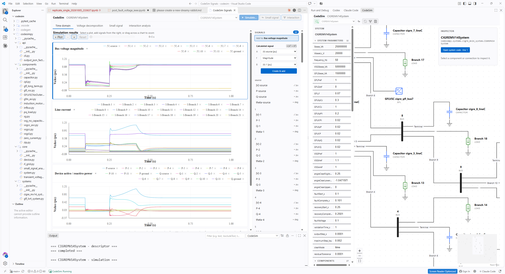
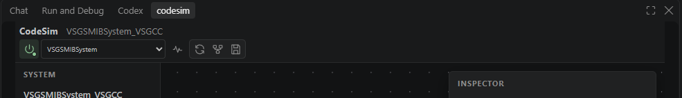

<p align="center">
  
</p>

# CodeSim - Building power system symbolically!

CodeSim is a Python-first toolkit for modelling and analysing converter-dominated power systems. 
It allows you to build device models and power systems completely based on symbolic equations.
This toolkit enables numerical simulation, small-signal and interaction analysis. The UI is based on VS Code extension, which facilitates developing your own device and system models.



## Features

Tired of dragging messy control blocks and circuit elements in Simulink / PSCAD?  Here are the reasons for choosing CodeSim!

- Symbolic EMT level device and network equations with inspectable state-space ODEs.
- Auto steady-state initialization and time-domain simulation.
- Small-signal modes, damping ratios, dominant states, and participation results.
- Converter-interaction analysis for identifying the critical feedback loop.
- Well-designed UI for tuning parameters, developing new models, thanks to VS Code platform.
- Transparent, AI-friendly, light-weight and fast startup.

## Requirements

- Python 3.10 or newer.
- Python packages: `numpy`, `scipy`, and `sympy` (installed automatically by pip). `numba` is optional.
- Visual Studio Code with the Microsoft Python extension for the graphical interface.
- Node.js and npm only when developing or rebuilding the extension.

## Quick start

### 1. Install the Python backend

Install Python 3.10 or newer, then clone this repository and install it with pip:

```powershell
python -m pip install git+https://github.com/NoClassDefError/codesimpy.git 
```

The package can then be used from Python (`import codesimpy`).

### 2. Install the VS Code extension

1. Open the VS Code **Extensions** view.
2. Open the `...` menu and choose **Install from VSIX...**.
3. Select the `codesim-frontend-*.vsix` file from the [frontend repository](https://github.com/NoClassDefError/codesim_frontend).
4. Reload the VS Code window.

### 3. Configure CodeSim

Then you should see the codesim dialog in the VS Code sidebar. If not, right click the left toolbar and select codesim.



Open the Command Palette (The textarea on the top of VSCode) and run:

- **Python: Select Interpreter** to choose the Python environment CodeSim will use.
- **CodeSim: Select Backend Directory** to select the `codesimpy` checkout from step 1 (keep the folder name `codesimpy`), or a folder that contains it.

CodeSim does not keep a separate Python executable setting. Each time the backend starts, it uses the active interpreter from the Microsoft Python extension for the current workspace. To switch environments, stop the CodeSim backend, run **Python: Select Interpreter**, choose the new environment, and start the backend again.

The only CodeSim path setting is:

```json
{
  "codesim-frontend.backendPath": "C:\\path\\to\\codesimpy"
}
```

Click 'Start python backend' icon, if successful, the button will turn green. Then you should see the example systems in the dropdown list.

### 4. Load and analyse a system

1. Select a system from the dropdown. Selecting it loads the model automatically.
2. Edit parameters or inspect components in the topology view.
3. Open **Signals** using the waveform icon.
4. Run **Simulate**, **Small signal**, or **Interaction** from the Signals toolbar.

The topology toolbar also provides refresh, automatic layout, and layout-save actions. The Signals view allows plots to be added or closed and signals to be assigned from the list on the right.

## Included systems

Systems are named like a serial number, `Network__Unit__Unit`. A unit is a converter with its filter, named
`Role_Control_Limiter_Filter`:

| Segment | Codes |
| --- | --- |
| Role | `GFM` grid-forming, `GFL` grid-following |
| Control | `A` virtual admittance + current PI; `V` voltage PI + current PI; `D` direct (internal voltage behind the filter, no inner loops); `P` GFL with outer P/Q loops; `C` GFL with current references |
| Limiter | `C` circular limit on the current reference; `L` linear adaptive virtual impedance; `S` smooth circular CLC; `H` hard circular CLC; `N` none; `F` GFL FRT/LVRT current priority |
| Filter | `LC` with filter (terminal) capacitor; `L` without |
| Network | `SMIB` one unit + infinite bus; `Parallel2` two GFMs + infinite bus; `CIGRE4` four-node CIGRE reduction (buses 7, 8, 9); `CIGRE4RX` the same with every series impedance at the grid R/X; `CIGRE14` full CIGRE MV feeder; `IEEE13` IEEE 13-node feeder |

| System | Description |
| --- | --- |
| `SMIB__GFM_A_C_LC`, `SMIB__GFM_V_C_LC`, `SMIB__GFM_D_N_LC` | One voltage-port GFM with its LC filter on an infinite bus |
| `SMIB__GFM_A_C_L` | GFM without terminal capacitor (grid impedance embedded in the device) |
| `SMIB__GFM_D_L_LC`, `SMIB__GFM_D_S_LC`, `SMIB__GFM_D_H_LC` | Direct GFM with linear adaptive VI, smooth or hard circular CLC |
| `SMIB__GFL_C_F_L`, `SMIB__GFL_C_F_LC`, `SMIB__GFL_P_F_LC` | GFL low-voltage ride-through studies: current references without / with terminal capacitor, outer P/Q loops with terminal capacitor |
| `SMIB__SG` | Synchronous generator on an infinite bus |
| `Parallel2__GFM_D_N_LC` | Two GFMs connected in parallel through separate branches |
| `CIGRE4__GFM_A_C_LC__GFL_C_F_L`, `CIGRE4__GFM_A_C_LC__GFL_P_F_L` | Four-node CIGRE reduction with the virtual-admittance GFM and the GFL without / with outer loop |
| `CIGRE4__GFM_D_S_LC__GFL_C_F_LC` | Four-node CIGRE reduction with the smooth-CLC GFM and both converter filter capacitors |
| `CIGRE4__GFM_A_C_L__GFL_C_F_L`, `CIGRE4__GFM_A_C_L__GFM_A_C_L`, `CIGRE4__GFM_A_C_L` | Four-node CIGRE reduction with the no-capacitor virtual-admittance GFM at bus 8 and a GFL, a second GFM, or nothing at bus 7 |
| `CIGRE4RX__GFM_A_C_L__GFM_A_C_L`, `CIGRE4RX__GFM_A_C_L` | As above on the R/X-matched corridor (Lemma 1/2) |
| `CIGRE14__GFM_A_C_LC__GFL_P_F_L`, `CIGRE14__GFM_A_C_LC__GFL_C_F_L` | Full CIGRE MV 14-bus feeder with GFM and GFL |
| `IEEE13`, `IEEE13__GFM_D_N_LC__GFL_P_F_L` | IEEE 13-bus feeder without / with converters |

Each class is one fixed configuration; its docstring gives the full description.

The backend service builds the frontend list from the exported system classes; it is not hard-coded in the extension.

## Project structure

The repository root is the `codesimpy` package. The VS Code extension lives in a separate [frontend repository](https://github.com/NoClassDefError/codesim_frontend).

```text
codesimpy/
├─ api/
│  ├─ cli.py                  Resident stdio service and analysis endpoints
│  └─ output_json_factory.py  Stdout and snapshot serialization
├─ components/                Converter, machine, source, and load models
├─ core/
│  ├─ device.py               Device base class
│  ├─ system.py               Initialization, integration, and signals
│  ├─ rl_grid.py              Symbolic/numerical RL network model
│  └─ small_signal_analyzer.py
├─ systems/                   Runnable system definitions
├─ tests/                     Python unit and service tests (not installed)
├─ docs/                      Model-building documentation
├─ registry.py                @system registry and workspace discovery
├─ pyproject.toml             Package metadata
├─ README.md
└─ LICENSE
```

Run the tests from the directory that contains the checkout:

```powershell
python -m unittest discover -s codesimpy/tests -t .
```

## Extending CodeSim

### Add a system

1. Add a `System` subclass under `systems/`.
2. Define its devices, network, base values, references, parameters, and parameter names.
3. Implement `calculateSignals(time_s, state, networkSignals)`.
4. Export it from `systems/__init__.py`.
5. Add `defaultParameters(overrides=None)` to the system class and expose it through the backend service.
6. Add a focused test under `tests/`.

### Add a component

Subclass `codesimpy.core.Device` and implement:

| Method | Purpose |
| --- | --- |
| `getStateAndOutputEquationsSym` | Return symbolic state equations and port outputs |
| `getPowerFlowEquations` | Return power-flow constraints |
| `initFromPowerFlow` | Construct the initial device state |
| `getFInit` | Return residual equations used during initialization |

Export the class from `components/__init__.py` and instantiate it in a system. Add a `deviceAppearance` mapping only when the frontend needs a dedicated category or icon.

## Current limitations

- Three-phase unbalanced systems have not yet been validated.
- Detailed switching models and switching events are not supported.
- The project is a research-oriented model library rather than a replacement for switching-level EMT tools.

## License and policies

CodeSim is licensed under the [Apache License, Version 2.0](LICENSE).

- Contributions: [CONTRIBUTING.md](CONTRIBUTING.md)
- Security reports: [SECURITY.md](SECURITY.md)
- Third-party notices: [THIRD_PARTY_NOTICES](THIRD_PARTY_NOTICES)
- Project name and logo: [TRADEMARKS.md](TRADEMARKS.md)
